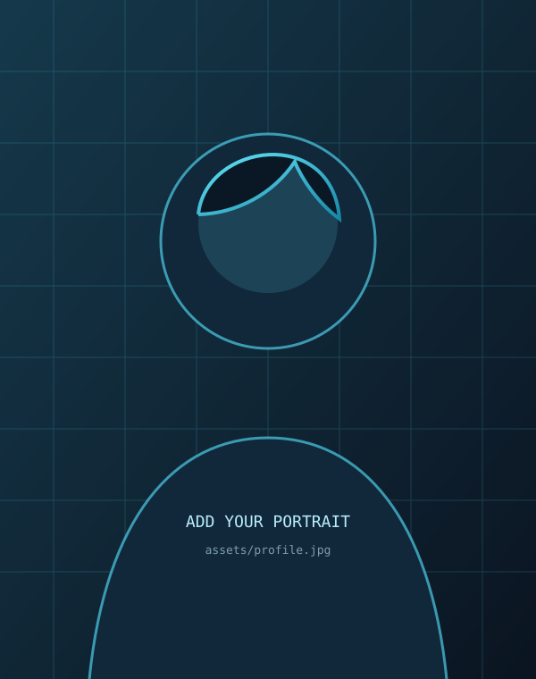

# Sylvestre Zongo — Personal Portfolio

A bilingual (English/French), responsive cybersecurity and development portfolio with a terminal-inspired visual identity.

## Stack
- HTML5
- CSS3 (responsive layout, animations, reduced-motion support)
- Vanilla JavaScript
- GitHub public contribution calendar endpoint

## Run locally
Open `index.html` in your browser. No build tools or package installation are required.

## Personalise before publishing

### 1. Add your portrait
Replace `assets/profile-placeholder.svg` as the displayed image by adding your own image as:

`assets/profile.jpg`

The HTML currently points to the placeholder. In `index.html`, change:
```html

```
to:
```html

```

Use a clear, professional portrait (square or vertical crop works best).

### 2. Confirm profile details
The GitHub username is set to `CyberSly0312` in `script.js`. Review the location, education, project descriptions and contact links in `index.html` and `script.js`.

### 3. Add your CV
When your CV is ready, place it in `assets/` and add a download link in the hero section.

## Publish with GitHub Pages
1. Create a repository named `CyberSly0312.github.io` (or use an existing portfolio repository).
2. Upload the contents of this folder to the repository root.
3. Open **Settings → Pages**.
4. Under **Build and deployment**, choose **Deploy from a branch**.
5. Select `main` and `/ (root)`, then save.
6. Your site will be available at `https://CyberSly0312.github.io` after deployment completes.

## Notes
- The contribution calendar is fetched from a public community endpoint. It may be unavailable temporarily; the page displays a fallback message.
- GitHub's unauthenticated REST API is not used for private data.
- Project links and descriptions should be checked before publishing.
- Do not add private credentials or API tokens to this static site.
